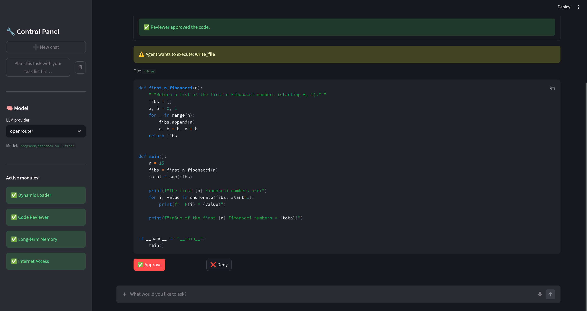

# AI Agent

A coding agent you can talk to in the browser or from the terminal. It plans tasks, reads and writes files in a dedicated workspace folder, runs Python scripts, searches the web, and asks for your approval before doing anything risky. It works with many LLM providers (Gemini, OpenAI, Anthropic, DeepSeek, OpenRouter, Azure, Ollama, ...), and you switch between them with one setting.

## About this project

This is a learning project. It started as the guided "Build an AI Agent" course on
[Boot.dev](https://www.boot.dev), which covered the basic agent loop and file tools on the
Gemini API. On top of the course version I added the multi-provider layer, streaming output,
chat history and working Approve/Deny buttons in the Streamlit app.

It is not meant for production use. Scripts run directly on your machine, not in an
isolated container, so treat it as a playground and read the code before approving it.



## Overview

- **Two interfaces:** a Streamlit chat app (`app.py`) and a one-shot CLI (`main.py`). Both stream the answer as it is written.
- **Many providers:** one `LLM_PROVIDER` setting in `.env` chooses the model backend. See [LLM providers](#llm-providers).
- **Tools:** list/read/write files, run Python files, install packages, search the web (Brave), and a task list for planning.
- **Safety:**
  - All file access is confined to the `agent_workspace/` folder.
  - Every Python file the agent writes is checked by a second "reviewer" model call first.
  - Writing a file, running a script and installing a package all need your explicit approval (Approve / Deny buttons in the app, `y/N` prompt in the CLI).
- **Chat history:** every conversation is saved. Start new chats, switch between them, or delete them from the sidebar.
- **Multimodal input (app):** attach images and record voice messages from the chat bar.

## Requirements

- Python 3.12 or newer
- [uv](https://docs.astral.sh/uv/) (install with your package manager, or `pip install uv`)
- An API key for at least one provider, or [Ollama](https://ollama.com) for local models with no key

## Setup

```bash
# 1. Install dependencies
uv sync

# 2. Create your config
cp .env.example .env
```

Open `.env`, choose a provider and fill in its key. For example, to use Gemini:

```
LLM_PROVIDER=gemini
GEMINI_API_KEY=your-key-here
```

Web search is optional. To enable it, add a [Brave Search API](https://brave.com/search/api/) key: `BRAVE_API_KEY=...`.

> `.env` holds secrets and is git-ignored. Never commit it. `.env.example` is the safe template.

## Run it

### Browser chat (recommended)

```bash
uv run streamlit run app.py
```

Open http://localhost:8501.

- **Chat bar:** type a message, use 📎 to attach images, or 🎤 to record a voice message.
- **Sidebar:** start a new chat, open or delete previous chats (🗑️), and pick the LLM provider. A red message appears if that provider's key is missing in `.env`.
- **Approvals:** before the agent writes a file, runs a script or installs a package, a card shows exactly what it wants to do. Nothing happens until you click **Approve** or **Deny**.

### Command line

```bash
uv run python main.py "Write a script that prints the first 10 primes, then run it"
```

| Flag | What it does |
|---|---|
| `--verbose` | Show provider, token counts and tool outputs |
| `--new` | Start a new chat (the previous one stays in the history) |

The CLI continues the chat that is currently open in the app, and asks `Allow? (y/N)` before writing or running files.

## LLM providers

Choose the provider with `LLM_PROVIDER` in `.env`:

| `LLM_PROVIDER` | Key(s) in `.env` | Default model |
|---|---|---|
| `gemini` (default) | `GEMINI_API_KEY` | `gemini-2.5-flash` |
| `openai` | `OPENAI_API_KEY` | `gpt-5-nano` |
| `anthropic` | `ANTHROPIC_API_KEY` | `claude-sonnet-5-5` |
| `deepseek` | `DEEPSEEK_API_KEY` | `deepseek-chat` |
| `openrouter` | `OPENROUTER_API_KEY` | `openai/gpt-4.1-mini` |
| `azure` | `AZURE_OPENAI_ENDPOINT`, `AZURE_OPENAI_API_KEY` | `gpt-4o-mini` (your deployment name) |
| `ollama` | none (runs locally) | `gemma4:e4b` (set `OLLAMA_CHAT` to change) |
| `proxy` | none ([teg-proxy](https://github.com/adrianstando/2026Z-PJATK-TEG/tree/main/tools/teg-proxy)) | `copilot/gpt-5-mini` |

**Tested with:** OpenRouter (`deepseek/deepseek-v4.1-flash`). The other providers are supported by the code and unit tests but have not been run end-to-end.

Set `LLM_MODEL` to use a different model with any provider. For example, OpenRouter with DeepSeek:

```
LLM_PROVIDER=openrouter
LLM_MODEL=deepseek/deepseek-v4.1-flash
OPENROUTER_API_KEY=your-key-here
```

In the app you can also switch provider from the sidebar, even in the middle of a chat. Your `.env` still needs that provider's key.

The model must support tool calling. Small local models often call tools badly.

## What the agent can do

| Tool | Purpose |
|---|---|
| `get_files_info` | List files in the workspace |
| `get_file_content` | Read a file (first 10,000 characters) |
| `write_file` | Create or overwrite a file (**needs approval**; `.py` files are reviewed first) |
| `run_python_file` | Run a Python file with a 30 s timeout (**needs approval**) |
| `install_package` | `pip install` a missing library (**needs approval**) |
| `search_web` | Search the web with Brave Search |
| `add_task`, `list_tasks`, `finish_task`, `clear_tasks` | Keep a to-do list for multi-step jobs |

The agent can also create **new tools** for itself: a Python file in `agent_workspace/` with a function and a `schema_<name>` dict is loaded as a tool (the template is in `prompts.py`).

## Chats and memory

Every conversation is saved in `agent_workspace/chats/`. Chats do not depend on the provider, so you can continue one with a different model. Deleting a chat in the sidebar removes its file for good.

## Safety notes

- File tools cannot leave `agent_workspace/`.
- `run_python_file` runs scripts **on your machine** (not in a container), with a 30 s timeout. The reviewer and your approval are the protection. Read the code on the approval card before you click Approve.
- `install_package` also needs your approval. It installs into this project's environment, so check the package name before you approve.
- Images and voice messages are sent to the selected provider. Do not attach anything you would not send to that service.

## Project layout

```
app.py              Streamlit chat app
main.py             Command-line interface
llm_provider.py     Provider table, client creation, streaming, Anthropic adapter
reviewer.py         Security review of generated Python code
call_function.py    Loads tools and executes tool calls
memory.py           Chat storage (history, active chat)
prompts.py          System prompt and reviewer prompt
config.py           Workspace path and limits
functions/          Built-in tools (one file per tool)
tests/              Test suite
agent_workspace/    The agent's workspace: its files, new tools, saved chats (git-ignored)
Dockerfile          Optional image with common data-science libraries (not used by the app itself)
```

## Development

```bash
uv run pytest              # run the tests
```

To add a tool, create a file in `functions/` with a function and a `schema_<name>` dict (see any file there, or the template in `prompts.py`). It is picked up automatically. If the function takes a `working_directory` parameter, it is filled in for you.
